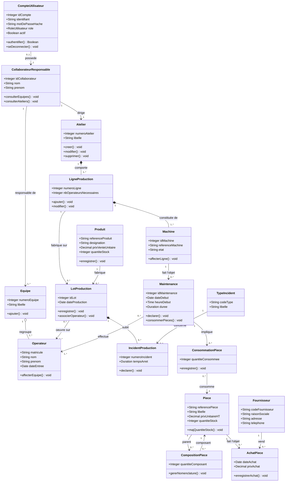
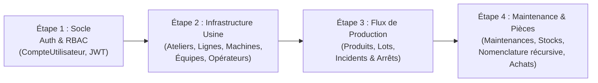

# DOSSIER DE RÉFÉRENCE DE CONCEPTION & D'ARCHITECTURE LOGICIELLE
## Système Informatisé de Gestion d'une Usine de Production
**Module :** Génie Logiciel & Méthodes Agiles — **Formation :** TWIN_3 — **Année :** 2026

---

## SOMMAIRE GÉNÉRAL DU DOSSIER

1. **CADRAGE DU PROJET & RÈGLES MÉTIER**
   - 1.1 Contexte et Objectifs Industriels
   - 1.2 Matrice des 4 Acteurs et Droits d'Accès (RBAC)
   - 1.3 Synthèse des 6 Domaines de Règles de Gestion Métier
2. **MODÉLISATION FONCTIONNELLE : LES 8 MODULES DU SYSTÈME**
   - 2.1 Découpage des 8 Modules
   - 2.2 Règles de Fonctionnement Dynamique (Vérifications & Exceptions)
3. **ARCHITECTURE STATIQUE DES DONNÉES (LES 17 CLASSES UML)**
   - 3.1 Dictionnaire Détaillé des 17 Entités et Classes d'Association
   - 3.2 Diagramme de Classes Global (Structure Relationnelle)
4. **ARCHITECTURE TECHNIQUE DE L'APPLICATION WEB**
   - 4.1 Modèle Architectural 3-Tiers Découplé
   - 4.2 Stack Technologique Justifiée (Django REST, React, PostgreSQL)
   - 4.3 Découpage Modulaire du Backend (Django Apps)
   - 4.4 Sécurité, Authentification & Administration
   - 4.5 Résolution des Contraintes Techniques Critiques (Nomenclature & Stocks)
5. **CADRE DE RÉFÉRENCE POUR LE DÉVELOPPEMENT DANS ANTIGRAVITY**
   - 5.1 Principes Directeurs pour l'Écriture du Code
   - 5.2 Ordre Logique d'Implémentation par Domaine

---

## 1. CADRAGE DU PROJET & RÈGLES MÉTIER

### 1.1 Contexte et Objectifs Industriels
Le projet vise la réalisation d'une application web industrielle intégrée permettant de piloter l'ensemble des activités opérationnelles d'une usine manufacturière :
* Suivre et tracer en temps réel l'organisation des ateliers et des lignes de production.
* Gérer les équipes d'opérateurs et leur affectation aux lots de fabrication.
* Déclarer et qualifier les incidents de production avec relevé systématique des temps d'arrêt.
* Suivre la maintenance préventive/curative des machines et la consommation des pièces de rechange.
* Piloter le stock des pièces détachées, la nomenclature multi-niveaux (BOM) et les achats fournisseurs.

### 1.2 Matrice des 4 Acteurs et Droits d'Accès (RBAC)

Toutes les actions métier nécessitent obligatoirement l'authentification préalable (`«include» S'authentifier`).

| Acteur | Périmètre Opérationnel & Responsabilités | Droits Système |
| :--- | :--- | :--- |
| **Responsable des Ateliers** | Pilotage physique de l'usine, création/modification des ateliers et lignes, catalogue des produits finis, lancement et suivi des lots de fabrication. | Lecture/Écriture sur Ateliers, Lignes, Produits, Lots. |
| **Collaborateur Responsable** | Encadrement des ressources humaines, constitution des équipes, affectation des opérateurs, enregistrement et suivi des incidents de production par lot. | Lecture/Écriture sur Équipes, Opérateurs, Incidents et Types d'incidents. |
| **Opérateur / Gestionnaire Stocks** | Consultation des machines, saisie des interventions de maintenance (durée, intervenants), décrémentation des pièces utilisées, gestion des nomenclatures et achats. | Lecture/Écriture sur Maintenances, Consommations, Pièces, Nomenclatures, Achats. |
| **Administrateur** | Supervision globale, gestion des comptes utilisateurs et habilitations, maintenance des référentiels transversaux (fournisseurs, types d'incidents). | Accès complet, paramétrage global, accès au back-office technique. |

### 1.3 Synthèse des 6 Domaines de Règles de Gestion Métier

1. **Ateliers & Lignes** :
   * L'usine est divisée en ateliers identifiés par `numeroAtelier` et `libelle`.
   * Un atelier possède un et un seul responsable (`CollaborateurResponsable`).
   * Chaque atelier comprend plusieurs lignes de fabrication.
   * Une ligne est définie par son `numeroLigne` et son `nbOperateursNecessaires`.
2. **Produits & Lots de Production** :
   * Un produit est identifié par `referenceProduit`, `designation`, `prixVenteUnitaire`, `quantiteStock`.
   * Chaque lot est unique : il associe la date de production, la ligne, le produit fabriqué et la liste des matricules des ouvriers ayant œuvré sur le lot.
3. **Opérateurs & Équipes** :
   * Un opérateur est identifié par son `matricule`, `nom`, `prenom`, `dateEntree`.
   * Un opérateur appartient à une seule équipe (`numeroEquipe`, `libelle`).
   * Une équipe n'a qu'un seul collaborateur responsable.
4. **Incidents de Production** :
   * Chaque incident possède un `numeroIncident`, un type d'incident (`codeType`, `libelle`) et un `tempsArret`.
   * Un incident concerne **un et un seul lot de production**.
5. **Machines & Maintenance** :
   * Une ligne est constituée de machines (`idMachine`, `referenceMachine`, `etat`). Une machine n'appartient qu'à une seule ligne.
   * La maintenance est effectuée par un ou plusieurs opérateurs, avec saisie de `dateDebut`, `heureDebut`, `duree`.
   * Lors d'une intervention, des pièces détachées peuvent être consommées.
6. **Pièces, Nomenclature & Fournisseurs** :
   * Une pièce est repérée par `referencePiece`, `libelle`, `prixUnitaireHT`, `quantiteStock`.
   * Une pièce peut être fournie par plusieurs fournisseurs (`codeFournisseur`, `raisonSociale`, `adresse`, `telephone`), avec historisation de chaque achat (`dateAchat`, `prixAchat`).
   * **Nomenclature (BOM)** : Une pièce peut intervenir à un ou plusieurs exemplaires dans la composition d'une autre pièce (arbre récursif sans boucle cyclique).

---

## 2. MODÉLISATION FONCTIONNELLE : LES 8 MODULES DU SYSTÈME

| Module | Intitulé | Acteur Principal | Cas d'utilisation majeurs |
| :--- | :--- | :--- | :--- |
| **M1** | Gestion des Ateliers & Lignes | Responsable Ateliers | Créer/Modifier/Consulter atelier, Ajouter/Supprimer ligne de fabrication. |
| **M2** | Gestion des Lignes & Lots | Responsable Ateliers | Créer lot de production, Associer produit, Affecter ouvriers par matricule. |
| **M3** | Gestion des Produits | Responsable Ateliers | Créer/Modifier produit, Consultation catalogue, Mise à jour stock fini. |
| **M4** | Gestion des Opérateurs & Équipes | Collaborateur Responsable | Créer équipe, Ajouter opérateur, Assigner opérateur à une équipe. |
| **M5** | Machines & Maintenance | Opérateur | Déclarer maintenance, Enregistrer temps/intervenants, Consommer pièces. |
| **M6** | Pièces & Nomenclature | Opérateur / Gest. Stocks | Gestion stock pièces, Gérer nomenclature (composition pièce parente / composante). |
| **M7** | Incidents de Production | Collaborateur Responsable | Définir types d'incidents, Déclarer incident sur un lot avec temps d'arrêt. |
| **M8** | Fournisseurs & Achats | Gestionnaire Stocks | Enregistrer fournisseur, Enregistrer achat avec mémorisation date et prix. |

---

## 3. ARCHITECTURE STATIQUE DES DONNÉES (LES 17 CLASSES UML)

Le système repose sur **17 classes et classes d'association** interconnectées :



---

## 4. ARCHITECTURE TECHNIQUE DE L'APPLICATION WEB

### 4.1 Modèle Architectural 3-Tiers Découplé
L'architecture sépare nettement les responsabilités en trois niveaux indépendants :
1. **Tier Présentation (Client SPA)** : Rendu de l'interface, gestion de l'état local, routage client, communication asynchrone par requêtes HTTP (JSON).
2. **Tier Métier (API REST)** : Point d'entrée sécurisé, validation des données d'entrée (`verifierDonnees`), exécution des règles d'intégrité, orchestration des transactions, exposition des ressources REST.
3. **Tier Données (Base Relationnelle)** : Persistance des tables, clés primaires/étrangères, index, verrouillage des transactions pour les écritures concurrentes.

### 4.2 Stack Technologique Retenue & Justifiée

* **Backend : Django 5 & Django REST Framework (Python)**
  * *Productivité & modularité* : Structure claire en applications métier indépendantes (`apps`).
  * *Back-office d'administration natif (`Django Admin`)* : Permet à l'Administrateur de manipuler immédiatement les référentiels de base (utilisateurs, fournisseurs, types d'incidents) sans attendre le développement de vues spécifiques.
  * *ORM puissant* : Prise en charge native des 17 classes, des relations $M:N$ avec attributs (`through=...`) et des types complexes (`DurationField` pour les temps d'arrêt).
  * *Sécurité & RBAC intégrés* : Authentification stateless par jetons **JWT** (`djangorestframework-simplejwt`), hachage automatique des mots de passe.
* **Frontend : React.js (avec Tailwind CSS / Shadcn UI)**
  * *Double ergonomie* : Tableaux de bord de supervision adaptés aux écrans fixes de bureau (responsables) et interfaces tactiles simplifiées à gros boutons adaptées aux tablettes d'atelier (opérateurs).
  * *Dynamisme* : Visualisation arborescente interactive pour la nomenclature récursive et formulaires réactifs pour la déclaration d'incidents et de maintenance.
* **Persistance : PostgreSQL (avec fallback SQLite en développement initial)**
  * *Intégrité transactionnelle* : Respect strict des contraintes d'intégrité référentielle.
  * *Capacité récursive* : Optimisation du parcours d'arbres de nomenclature (`WITH RECURSIVE`).

### 4.3 Découpage Modulaire du Backend (Django Apps)

Le code backend est partitionné en 5 applications isolées correspondant aux domaines de l'usine :

```text
backend/
├── config/                     # Configuration globale (settings, urls, jwt, cors)
├── apps/
│   ├── authentification/      # CompteUtilisateur (rôles RBAC, login JWT)
│   ├── usine/                 # Atelier, LigneProduction, Machine, CollaborateurResponsable, Equipe, Operateur
│   ├── production/            # Produit, LotProduction, IncidentProduction, TypeIncident
│   ├── maintenance/           # Maintenance, ConsommationPiece
│   └── stock_achats/          # Piece, CompositionPiece (Nomenclature), Fournisseur, AchatPiece
└── manage.py
```

### 4.4 Sécurité, Authentification & Droits (RBAC)
* **Modèle d'authentification** : `CompteUtilisateur` hérite de `AbstractUser` et stocke le rôle de l'utilisateur (`RESPONSABLE_ATELIER`, `COLLABORATEUR`, `OPERATEUR`, `ADMIN`).
* **Protection des endpoints** : Permissions personnalisées DRF (`IsResponsableAtelier`, `IsOperateur`, etc.) appliquées sur chaque contrôleur.
* **Échange sécurisé** : Jetons d'accès JWT (`Bearer <token>`) à durée limitée avec jeton de rafraîchissement (`refresh token`).

### 4.5 Résolution des Règles Métier Critiques

1. **Décrémentation Transactionnelle du Stock (`ConsommationPiece`)** :
   * Chaque déclaration de maintenance consommant des pièces est encapsulée dans un bloc transactionnel `@transaction.atomic`.
   * Le système vérifie `quantiteStock >= quantiteConsommee`. En cas de succès, la pièce est décrémentée via une requête atomique SQL (`F('quantiteStock') - quantite`). En cas de stock insuffisant, une exception est levée et la transaction est annulée.
2. **Nomenclature Récursive et Anti-Cycle (`CompositionPiece`)** :
   * La relation réflexive est portée par `CompositionPiece(quantiteComposant)`.
   * Avant chaque création ou modification de lien composant/composé, un algorithme de détection de cycle (parcours en profondeur DFS) s'assure que la pièce parente ne se retrouve pas dans sa propre descendance.
3. **Traçabilité des Lots et Incidents (`IncidentProduction`)** :
   * L'incident est strictement lié à un lot unique (`ForeignKey(LotProduction)`). Le temps d'arrêt est validé et mémorisé sous forme de durée pour permettre l'agrégation statistique des arrêts machines.

---

## 5. CADRE DE RÉFÉRENCE POUR LE DÉVELOPPEMENT DANS ANTIGRAVITY

Pour guider les étapes de développement dans Antigravity sans ambiguïté, les consignes directrices suivantes s'appliquent :

### 5.1 Principes Directeurs
1. **Fidélité stricte au dictionnaire de données** : Les noms des attributs et leurs types doivent refléter exactement les 17 entités du diagramme UML.
2. **Architecture en couches étanches** :
   * Les modèles (`models.py`) portent les champs et contraintes de tables.
   * La logique métier et les contrôles (`verifierDonnees`, contrôle de stock, cycle BOM) sont logés dans des services ou méthodes de validation dédiées.
   * Les sérialiseurs (`serializers.py`) valident la structure JSON et gèrent les conversions.
   * Les vues (`views.py` / `ViewSets`) orchestrent les réponses HTTP.
3. **Sécurisation par défaut** : Tout nouvel endpoint doit être explicitement rattaché à une permission du rôle adéquat.

### 5.2 Ordre Logique de Construction des Blocs



Ce document constitue la **spécification maîtresse unique** du projet pour toute la suite de la réalisation dans Antigravity.

